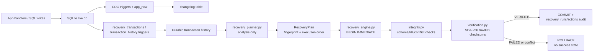
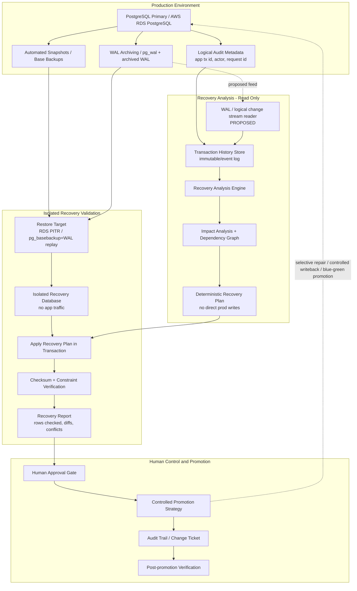

# Production Recovery Architecture

## Status and honesty boundaries

This document covers **Phase 8: Production Recovery Architecture** for the Time-Travel DB & Bug Rewinder repository as inspected on 2026-11-22.

| Area | Status | Evidence |
|---|---|---|
| SQLite logical row-level transaction history (`transaction_history`, triggers, transaction grouping) | **Implemented** | `timetravel/recovery/transaction_logger.py`, `timetravel/recovery/change_tracker.py`, `timetravel/db.py` |
| Deterministic recovery planning and analysis/execution separation | **Implemented** | `timetravel/recovery/recovery_planner.py`, `timetravel/recovery/recovery_engine.py` |
| UPDATE/DELETE/INSERT compensation with conflict detection, FK-aware ordering, atomic rollback, audit records | **Implemented** | `timetravel/recovery/integrity.py`, `timetravel/recovery/dependencies.py`, `timetravel/recovery/recovery_engine.py` |
| SHA-256 row/database checksum verification blocking success on mismatch | **Implemented** | `timetravel/recovery/verification.py`, integrated by `recovery_engine.execute_plan()` |
| Unit/integration tests for recovery engine and two crash scenarios | **Tested in this workspace** | `python3 -m unittest discover -s tests -p 'test_*.py'` → 86 tests, OK; `python3 tests/e2e.py` passing in an isolated copy |
| Benchmark suite scripts | **Implemented** | `benchmarks/generate_data.py`, `benchmarks/benchmark_recovery.py` |
| Full benchmark results/report for 1k/10k/100k/500k x 3 iterations | **Complete** | `benchmarks/benchmark_results.json` and `BENCHMARK_REPORT.md`; 12/12 runs committed and `VERIFIED`, 0 errors. |
| PostgreSQL WAL parsing, logical decoding consumer, or PostgreSQL recovery executor | **Proposed only — not implemented** | No PostgreSQL binaries/drivers in environment (`psql/initdb/postgres` not found; `psycopg`/`psycopg2` not installed); no Postgres recovery code in repo. |
| AWS RDS automated backup / PITR integration | **Proposed only — not implemented** | No AWS SDK, credentials workflow, RDS API calls, or restore automation in repo. |
| Isolated PostgreSQL proof of concept | **Not feasible in current environment** | Missing PostgreSQL server/tooling and Python Postgres driver; no PoC claimed. |

**Rule:** this document does not claim native WAL parsing, AWS RDS integration, or production deployment has been implemented or tested unless explicitly listed above as implemented/tested.

## Current prototype architecture (actual)

### What the prototype actually does

- **Captures** supported `INSERT/UPDATE/DELETE` operations on registered business tables (`customers`, `inventory`, `orders`, `order_items`) with transaction ID, event sequence, timestamp, table, PK, old/new JSON values.
- **Plans** compensating steps deterministically from history; analysis is read-only.
- **Validates** plan shape/schema, expected current row state, unique constraints, FK dependencies, and simulated execution before live apply.
- **Executes** in a controlled SQLite transaction; records `recovery_runs`/`recovery_actions`.
- **Verifies** recovered state against a reference/baseline checksum; fails closed on mismatch.

### Prototype limitations

- **SQLite-specific**: triggers, `json_object`, `sqlite3` backup/connection semantics, single-node file DB.
- **Scoped capture**: only registered business tables and DML ops captured by installed triggers; no DDL, no external/system changes, no unmanaged tables.
- **Identity limits**: single-column PK registry; PK-changing updates and some complex FK patterns are unsupported/rejected.
- **Not PostgreSQL WAL**: current "history" is logical trigger capture, not physical/logical WAL decoding.
- **Not production HA/DR**: no replication, no automated failover, no backup catalog, no PITR restore orchestration, no RBAC/audit pipeline beyond local tables.
- **Cutover boundary**: DB recovery is atomic in SQLite transaction; application code patching in legacy demo flow is separate and not a distributed atomic commit.
- **Operational scale**: benchmark suite exists, but full 500k x 3 measured report was not completed at Phase 8 documentation time.

## Target production architecture (proposed)

The production design keeps the prototype's core principle: **analyze first, execute in isolation, verify checksums, require human approval, then promote deliberately**.

## PostgreSQL WAL, checkpoints, backups, and PITR

### Write-Ahead Logging (WAL)

**Proposed use, not implemented here.** PostgreSQL WAL records changes before corresponding data files are persisted. For recovery, WAL provides:

- **Durability and crash recovery**: PostgreSQL replays WAL during startup after a crash.
- **Physical replication**: standbys replay WAL.
- **Point-in-time recovery**: base backup + WAL replay can restore to a target time/LSN/xid/name.
- **Change analysis source**: logical decoding can expose row changes from WAL for auditing/recovery analysis, subject to configuration and retention.

**Design implication:** WAL is the authoritative low-level change stream, but raw WAL is not a safe direct "undo button". A recovery engine should translate WAL/logical changes into a reviewed compensation plan, validate on an isolated restore, and only then promote.

### Checkpoints

**Proposed use.** Checkpoints flush dirty buffers and record a point from which crash recovery can start. They bound crash-recovery replay time but do **not** replace backups/PITR. Checkpoint tuning affects write amplification and recovery time; production recovery procedures should record checkpoint/WAL settings in incident reports.

### Database backups

**Proposed use.** Production needs regular base backups/snapshots plus continuous WAL archiving. Backups provide the restore starting point; WAL provides changes after backup. Backups must be tested with restore drills; an untested backup is not a recovery capability.

### Point-in-time recovery (PITR)

**Proposed use.** PITR restores a database to a specific recovery target by restoring a base backup and replaying WAL up to that target. This is suitable for creating an **isolated validation database** at/just before an incident, or reconstructing pre-incident state for comparison. PITR is not the same as selective business-row undo; it is a coarse restore mechanism that recovery analysis can leverage safely.

## AWS RDS automated backups and PITR

**Proposed use, not implemented.** For AWS RDS PostgreSQL:

- **Automated backups**: RDS can take daily snapshots and retain transaction logs to support PITR within the configured backup retention window.
- **RDS PITR**: restore creates a **new DB instance** to a specified point in time; it does not overwrite the source instance in place.
- **Operational fit**: this maps well to the isolated-recovery pattern - restore an incident-time copy, run recovery analysis/verification against it, then promote selected corrected data through controlled application workflows.

**Constraints to document in production:** PITR window limited by backup retention; restore creates new endpoint/instance; parameter groups, security groups, IAM, KMS keys, extensions, and app connectivity must be validated; large databases have non-trivial restore time.

## Isolated recovery database workflow

1. **Detect incident** from alerts, audit logs, app telemetry, or integrity checks.
2. **Preserve evidence**: snapshot identifiers, WAL range/LSN/time window, application request IDs, affected tables/keys.
3. **Restore isolated copy** using RDS PITR or PostgreSQL base backup + WAL replay to a target before or around the incident. No production traffic.
4. **Reconstruct/analyze changes** using logical audit stream, WAL-derived change records, or application transaction history. Do not run arbitrary AI-generated SQL.
5. **Generate deterministic recovery plan**: explicit row operations, dependency order, preconditions, conflict rules.
6. **Apply plan in isolated DB transaction**; capture before/after checksums and constraint checks.
7. **Verify**: row counts, PK/FK/unique/check constraints, checksums, business invariants, sample queries, audit diff.
8. **Human approval** with report and rollback/promotion plan.
9. **Controlled promotion**: selective repair, idempotent backfill, or staged cutover. Never blindly replace production without impact analysis.
10. **Post-promotion verification** and incident audit record.

## Security and permissions requirements

**Proposed production controls:**

- **Least privilege IAM/DB roles**: separate roles for backup restore, read-only analysis, isolated recovery write, and production promotion.
- **No direct production write from analysis agent**. Analysis engine gets read-only/audit access; execution against production requires human-approved change path.
- **Secrets management**: AWS Secrets Manager/SSM Parameter Store/KMS; no credentials in repo or logs.
- **Network isolation**: isolated recovery DB in private subnet/security group; no public exposure; restricted ingress from recovery tooling only.
- **Encryption**: KMS at rest for RDS/snapshots/backups; TLS in transit.
- **Auditability**: immutable audit log for who requested, generated, approved, executed, and promoted recovery; include plan fingerprint/checksums.
- **Data handling**: production restores contain sensitive data - apply same PII controls, masking where possible, retention limits, and access logging.
- **Change management**: ticketed approval, two-person review for high-risk repairs, maintenance window for promotion.

## Safe promotion of recovered data

**Proposed strategies, chosen by incident type:**

- **Selective compensating writes**: generate reviewed, parameterized/idempotent SQL or application-level repair jobs for specific keys. Best for small, well-understood damage.
- **Staged table repair**: write corrected rows into staging/repair tables, verify, then swap/merge in controlled transaction/window.
- **Blue/green or restored-instance promotion**: only when entire database state is intended to move; requires connection draining, write freeze, compatibility checks, and rollback plan. RDS PITR creates a new instance, so endpoint cutover must be deliberate.
- **Never**: execute raw AI SQL on production; overwrite rows without precondition checks; skip checksum/constraint verification; promote when unexpected diffs exist.

Every promotion should have: pre-promotion snapshot, exact row/key scope, maintenance window/write pause plan, verification queries, and rollback procedure.

## Limitations of the existing prototype

- Uses SQLite trigger-based logical history, not PostgreSQL WAL/logical decoding.
- No PostgreSQL schema/type/transaction semantics (MVCC, WAL LSNs, replication slots, sequence behavior beyond demo).
- No RDS API integration, no restore orchestration, no cross-instance promotion.
- Recovery scope limited to registered tables and supported DML.
- Some cases intentionally rejected: PK changes, composite/self-ref/complex FK scenarios, DDL, out-of-band writes.
- Benchmark results are measured only on this SQLite prototype; they do not establish production PostgreSQL/RDS performance.
- No authn/authz, no multi-user approval workflow, no tamper-evident external audit log.

## Recommended next implementation steps (proposed)

1. **Use the completed Phase 7 artifacts** as the evidence baseline before proposing further recovery-engine changes.
2. **Add Postgres-compatible transaction history adapter** behind a clear interface; keep SQLite prototype for tests/demos.
3. **Build isolated PostgreSQL PoC** in an environment with Postgres installed: capture changes, restore isolated DB, run deterministic compensation plan, verify checksums. Only claim implemented after tests pass.
4. **Design RDS PITR runbook/integration** as a separate, explicitly approved feature: restore new instance, validate, generate repair plan, human approval, controlled promotion.
5. **Add production controls**: auth/RBAC, approval workflow, immutable audit log, secrets handling, observability, rollback automation.

## Feasibility note: PostgreSQL PoC

A small isolated PostgreSQL PoC was **not built** in this phase because the current environment lacks PostgreSQL server/tooling (`psql`, `initdb`, `postgres`, `pg_ctl` not found) and Python PostgreSQL drivers (`psycopg`/`psycopg2` not installed). Installing system services/drivers would be an environment/dependency change and was not performed. This is reported honestly; no PoC implementation is claimed.
