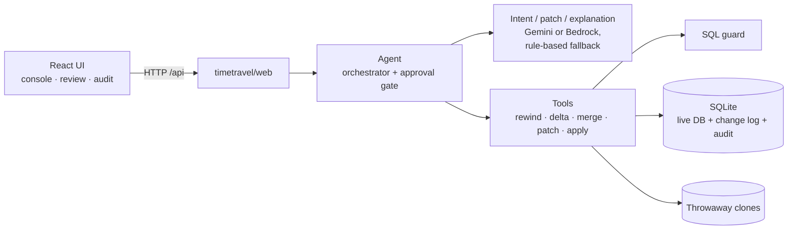

# Time-Travel DB & Bug Rewinder

[](https://github.com/HamidKhan1001/Time-Travel_db_and_bug_rewinder/actions/workflows/ci.yml)


**Recover a corrupted database without losing the good writes that happened after the crash, and fix the bug that caused it.**

When a bad deploy wipes a table, the usual options are to restore last night's backup (and lose every order placed since) or to repair rows by hand at 3 a.m. Time-Travel DB does a third thing: it rewinds a *copy* of the database to just before the crash, replays the legitimate writes on top, finds and patches the faulty code, and waits for a human to approve before touching production. Every apply can be undone.

> Status: working prototype on SQLite. It demonstrates the idea end to end; it is not a production recovery system (see [Limitations](#limitations)).

## The demo in 60 seconds

An online shop's warehouse-sync endpoint runs `UPDATE inventory SET stock = ?` with no `WHERE` clause. One request zeroes the stock of all 1,420 SKUs, and three customers keep ordering while it is broken.

1. **Sync Warehouse** wipes inventory. **Place 3 Orders** adds orders #1041-#1043, one of which oversells a limited item.
2. **Run time-travel** with a plain-English prompt, for example *"Take the business back to before the crash, keep the 3 orders, and fix the bug."*
3. The agent works on a clone: rewind, extract what changed after the crash, merge, resolve the oversell, find the bad statement in the source, propose and test a patch.
4. You review the merge plan, conflict, risk score and patch diff, then **Approve & go live**.
5. **Re-run Sync**: the patched handler now touches **1 row** instead of 1,420.
6. Optionally **Undo recovery**. The audit log records the whole story.

## Quick start

### Docker

```bash
docker compose up --build
# open http://127.0.0.1:8000/app/
```

The container runs as a non-root user, publishes the port on the host's loopback only, and has a health check. See [Configuration](#configuration) for the optional API token and AI provider.

### Local

Requirements: Python 3.11+ (CI tests 3.11 and 3.12), Node.js 20.19+ or 22.12+ to build the UI.

```bash
cd frontend && npm install && npm run build:live && cd ..
python3 server.py
# open http://localhost:8000  (redirects to /app/)
```

`python3 reset.py` restores the clean seeded state and the intentionally buggy handler. It deletes the generated databases in `data/`.

### Frontend development

```bash
cd frontend
npm run dev        # mock data, no backend needed (good for design work)
npm run dev:live   # real backend: run `python3 server.py` in another terminal
```

## How it works



The model only *proposes*. Deterministic code verifies every proposal on a clone, the SQL guard blocks dangerous statements, and nothing reaches production without a human clicking approve. Full diagrams, the session state machine and the trust boundaries are in [docs/ARCHITECTURE.md](docs/ARCHITECTURE.md); the reasoning behind the main choices is in [docs/adr/](docs/adr/).

## Project layout

```
server.py              entry point (`python3 server.py`); the implementation is timetravel/web/
reset.py               restore the seeded demo state
timetravel/            the engine (standard library only)
  agent.py               orchestrator, approval gate, undo, discard
  tools.py               rewind_branch, extract_delta, plan_merge, diagnose_and_patch, apply_recovery
  db.py                  schema, change-log triggers, clone and reverse
  guard.py               deterministic SQL policy
  config.py              every setting, read from the environment and validated once
  ratelimit.py           token-bucket limiter
  web/                   HTTP layer: context, router, security, handler, routes/, static, streaming
  audit.py               durable audit events and recovery history
  llm/                   intent parsing, patch proposal, explanations (+ regex fallback)
  recovery/              transaction history, plans, FK-aware execution, checksum verification
app/ seed/             the demo storefront handler (intentionally buggy) and its pristine copy
frontend/              React + Vite + Tailwind UI, adapters, unit and Playwright tests
evals/                 hand-labelled prompts that score the intent parsers
tests/                 Python test suite
benchmarks/ scripts/   benchmark harness and the CLI demo
docs/                  architecture, ADRs, OpenAPI spec, evidence and analysis notes
```

## Configuration

| Variable | Default | Purpose |
|---|---|---|
| `PORT` / `HOST` | `8000` / `127.0.0.1` | Listen address. Containers set `HOST=0.0.0.0`. |
| `TT_API_TOKEN` | unset | If set, every `/api` route except `/api/health` needs `Authorization: Bearer <token>`. In the browser run `localStorage.setItem('tt_api_token', '<token>')` once. |
| `TT_LOG_LEVEL` | `INFO` | Access log level. Each line carries a request ID (also returned as `X-Request-Id`). |
| `TT_MAX_BODY_BYTES` | `1048576` | Largest accepted POST body. Bigger requests get `413`. |
| `TT_REQUEST_TIMEOUT` | `30` | Seconds before a stalled client connection is dropped. |
| `TT_MAX_SSE_STREAMS` | `32` | Concurrent `/events` streams. Over the cap returns `503` with `Retry-After`. |
| `TT_MAX_SESSIONS` | `200` | In-memory sessions kept. Finished ones are evicted first; running ones never are. Audit history stays in the DB. |
| `TT_CHANGELOG_MAX_ROWS` | `500000` | Newest legacy changelog rows kept (pruned every 10 min). `0` keeps everything. Rewinding past the oldest kept row is not possible. |
| `TT_RATE_LIMIT` | `1` | Master switch for rate limiting (`0` turns it off). |
| `TT_RATE_READ_PER_MIN` / `TT_RATE_READ_BURST` | `600` / `120` | Reads per client address: sustained rate and the burst allowed at once. Over the limit: `429` + `Retry-After`. |
| `TT_RATE_WRITE_PER_MIN` / `TT_RATE_WRITE_BURST` | `60` / `20` | Same for `POST` (starting, approving, undoing recoveries). |
| `TT_RATE_AUTH_FAIL_PER_MIN` | `10` | Failed token attempts per address before it is locked out (`429`) until the bucket refills. |
| `TT_TRUST_PROXY` | `0` | Believe `X-Forwarded-For` (right-most entry) for rate limiting. Only enable behind a proxy you control. |
| `TT_ALLOWED_ORIGINS` | unset | Comma-separated exact origins allowed for CORS and cross-origin `POST`. Unset = local dev servers only. The app served by this server can always call it. |
| `TT_ALLOWED_HOSTS` | unset | Accepted `Host` names. Unset = automatic: loopback names only while bound to a loopback address (DNS-rebinding defence). |
| `TT_CSP` | built-in policy | Content-Security-Policy header. Empty disables it. |
| `TT_DEMO_ROUTES` | `1` | `0` hides `/api/demo/*` (reset, crash, orders). Turn off on anything public. |
| `TT_DEMO_SKU` | `APX-0007` | SKU the demo "warehouse sync" marks sold out. |
| `TT_DATA_DIR` | `./data` | Where the SQLite files live. |
| `TT_PACE` | `0.4` | Seconds between agent steps so the demo feed is readable. `0` for tests. |
| `TT_LLM_PROVIDER` | `gemini` | `gemini` or `bedrock`. Without credentials the rule-based parser is used. |
| `GEMINI_API_KEY`, `TT_LLM_MODEL`, `TT_BEDROCK_REGION`, `TT_BEDROCK_MODEL` | | Provider settings. See [docs/ai-setup.md](docs/ai-setup.md). |
| `TT_LLM_TIMEOUT`, `TT_LLM_MIN_CONFIDENCE`, `TT_LLM_EXPLAIN` | `10`, `0.7`, `true` | Timeout, confidence below which the UI warns, merge explanations on/off. |

Install an AI provider SDK with `pip install ".[gemini]"`, `".[bedrock]"` or `".[ai]"` (Docker: `--build-arg EXTRAS=gemini`).

## API

Machine-readable reference: [docs/openapi.json](docs/openapi.json). Narrative reference with session fields and SSE events: [API.md](API.md). Health check: `GET /api/health`.

## Testing and quality

```bash
pip install -e ".[dev]"

ruff check .                                      # lint (real-bug rules)
mypy                                              # type check
TT_PACE=0 python3 tests/run_ci_suite.py           # full Python suite
coverage run tests/run_ci_suite.py && coverage report   # 75% floor, currently ~79%
TT_PACE=0 python3 tests/e2e_isolated.py           # headless demo in a temp copy
python3 evals/run_evals.py                        # intent-parser scores

cd frontend
npm run lint && npm test                          # ESLint + adapter tests
npm run test:e2e                                  # Playwright click-through against the real server
```

CI (`.github/workflows/ci.yml`) runs all of the above plus dependency audits and a Docker build, then a single **Quality gate** job. Do not run `tests/e2e.py` directly from the repo root if you want to keep `data/` and `app/handlers.py`; use `e2e_isolated.py`.

### How good is the AI part?

`python3 evals/run_evals.py` scores the prompt parser against 24 hand-labelled prompts. The rule-based fallback currently gets **16/24**: perfect on plain phrasing and units, but 1 of 7 on paraphrases ("half an hour ago", "preserve the orders", "do not fix anything"). That gap is what the LLM path is for. Run with `--llm` and credentials to measure it. The LLM path has been tested with mocks only; it has not been scored against a live model yet.

## Pull requests and the bot

Every PR runs the quality gate. When it passes, **hamid_bot** approves low-risk PRs automatically; changes to CI, the SQL guard or dependency manifests always need a human. Details in [CONTRIBUTING.md](CONTRIBUTING.md).

## Documentation

- [Architecture](docs/ARCHITECTURE.md) and [decision records](docs/adr/)
- [API reference](API.md) and [OpenAPI spec](docs/openapi.json)
- [AI provider setup](docs/ai-setup.md)
- [Audit persistence and lifecycle](docs/AUDIT.md)
- [Recovery engine scope](docs/DATABASE_ENGINE_README.md), [limitations](docs/DATABASE_LIMITATIONS.md), [second crash scenario](docs/SECOND_CRASH_SCENARIO.md)
- [Production recovery architecture](docs/PRODUCTION_RECOVERY_ARCHITECTURE.md) (prototype plus proposed design)
- [Performance](docs/PERFORMANCE.md) and [benchmark report](docs/BENCHMARK_REPORT.md); raw run files in [docs/evidence/](docs/evidence/)
- [Product requirements (PDF)](docs/PRD.pdf), [devlog](docs/devlog.md) (historical notes)
- [Changelog](CHANGELOG.md), [security policy](SECURITY.md)

## Other demonstration: orders status wipe (recovery engine only)

A second scenario uses the recovery engine directly, without the HTTP approval gate:

```bash
tmpdir=$(mktemp -d)
python3 tests/setup_second_crash.py --dir "$tmpdir"
python3 tests/run_second_crash.py --dir "$tmpdir"
```

See [docs/SECOND_CRASH_SCENARIO.md](docs/SECOND_CRASH_SCENARIO.md). It is not exposed in the UI yet. A command-line version of the main demo with a checksum verification step is `python3 scripts/final_recovery_demo.py`.

## Limitations

- **SQLite only.** No PostgreSQL WAL decoding or AWS RDS point-in-time recovery; those are described as a proposed design, not implemented.
- Change capture is trigger-based on registered business tables and DML only. DDL, unregistered tables and out-of-band writes are not captured.
- **Security is demo-grade.** One optional shared token, no users or roles. Keep the port on loopback, or set a token and add TLS in front.
- Sessions live in memory (audit events are durable in SQLite). **Reset demo** clears the audit history because it lives in the database that is reset.
- Database recovery and source-code patching are two operations, not one distributed transaction.
- The browser UI does not yet display the server's `recovery_preview` / `actual_recovery` / `verification` fields.
- Local benchmarks are measurements from specific machines, not an SLA. `integrity_status: VERIFIED` covers the configured business tables, not the whole database file.
