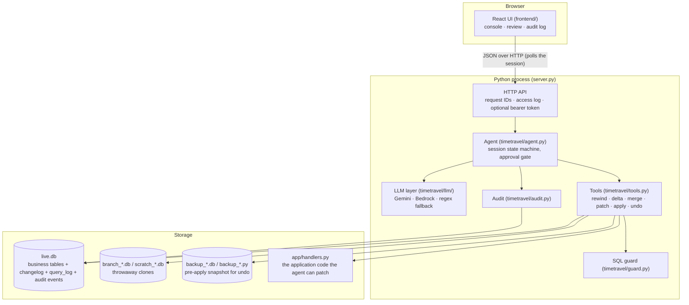
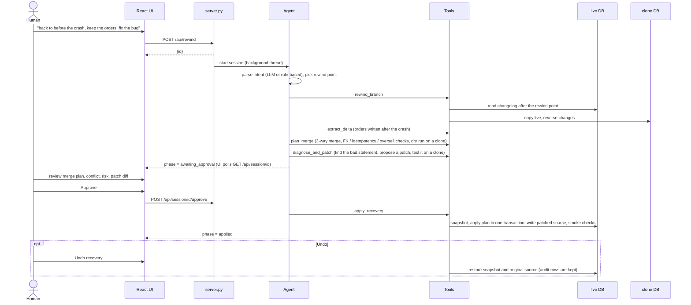
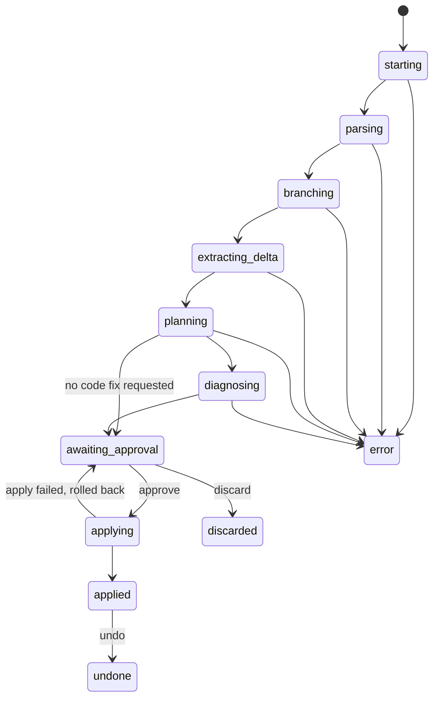

# Architecture

Time-Travel DB recovers a corrupted database by rewinding a *copy* of it, merging the legitimate writes that happened after the crash, patching the faulty code, and applying the result only after a human approves. This page shows how the pieces fit. The reasoning behind the main choices is in [adr/](adr/).

## System context

## What happens during a recovery

Nothing before the Approve step writes to the live database. Rewind, merge and patch testing all happen on clones.

## Session state machine

`error` is reached only before the plan exists, so production is never touched by a failed run. `discarded`, `applied` and `undone` are terminal for the audit log; a failed apply is not (the plan is still actionable).

## Safety boundaries

| Boundary | What enforces it | What it prevents |
|---|---|---|
| The model never writes data | LLM output is a *proposal* (intent, patch text, explanation) validated against a schema; invalid output, an error, or a low-confidence patch falls back to the rule-based path | A hallucinated patch or intent reaching production |
| Proposals are verified before a human sees them | The merge is dry-run on a clone with integrity checks; the patch is run against tests on a clone | Approving something that does not work |
| Dangerous SQL is blocked | `guard.py` rejects `DROP`, `TRUNCATE`, `ALTER` and unscoped `UPDATE`/`DELETE` without approval; fuzz-tested | An agent or script destroying more data |
| A human gates the apply | `approve` only works in `awaiting_approval`; `discard` leaves data untouched | Autonomous production changes |
| Apply is atomic and reversible | One transaction, smoke checks, a pre-apply snapshot of the DB and source | A half-applied recovery; a bad recovery that cannot be backed out |
| The trail survives undo | Audit rows are re-inserted after the snapshot restore | Losing the record of what was undone |
| The API surface is small | Optional bearer token; POSTs from non-local origins get 403; CORS for localhost only | A web page on another site driving the demo server |

## Data model

| Table | Purpose |
|---|---|
| `customers`, `inventory`, `orders`, `order_items` | The business data being protected |
| `changelog` | Row-level change stream written by triggers (table, operation, primary key, old and new values as JSON). Rewind replays it backwards |
| `query_log` | Every statement the app handlers run, with rows affected. This is how the incident is found: an unscoped write touching many rows |
| `session_audit_events` | Durable lifecycle events per session (initiated, preview generated, approved, completed, undone, ...). Feeds the audit page and the SSE stream |
| `transaction_history` and `recovery_*` (timetravel/recovery/) | Transaction grouping, plans, runs and actions for the recovery engine, with SHA-256 checksum verification |

## Module map

| Area | Files |
|---|---|
| HTTP | `server.py` |
| Orchestration | `timetravel/agent.py`, `timetravel/sse.py`, `timetravel/recovery_projection.py` |
| Recovery tools | `timetravel/tools.py`, `timetravel/db.py`, `timetravel/seed.py`, `timetravel/appcode.py` |
| Safety | `timetravel/guard.py`, `timetravel/audit.py` |
| AI | `timetravel/llm/` (`_provider.py` Gemini and Bedrock, `_tasks.py`, `_schemas.py`, `_fallback.py`) |
| Recovery engine | `timetravel/recovery/` |
| UI | `frontend/src/` (`services/backend.js` and `adapters.js` translate the API into what the screens read) |

## Scaling and production gaps

The design is deliberately small enough to read in an afternoon. What a production version would change is listed in [PRODUCTION_RECOVERY_ARCHITECTURE.md](PRODUCTION_RECOVERY_ARCHITECTURE.md): PostgreSQL logical decoding or RDS point-in-time recovery instead of triggers, a real job queue and durable sessions instead of threads and memory, per-user auth and roles, and a message broker instead of SQLite polling for events. Known limits of the prototype are in [DATABASE_LIMITATIONS.md](DATABASE_LIMITATIONS.md) and the README.
